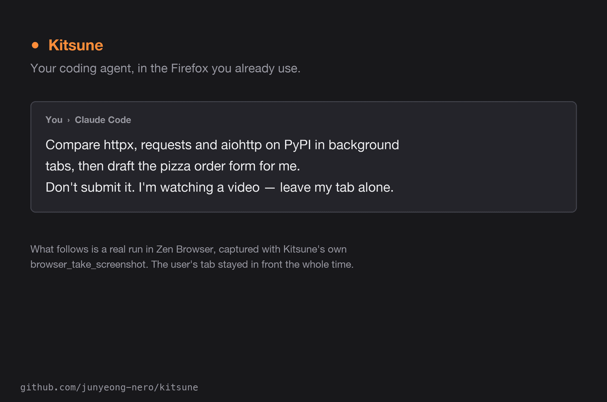

# Kitsune

<!-- mcp-name: io.github.junyeong-nero/kitsune -->


[](https://pypi.org/project/kitsune-browser-mcp/)
[](https://pypi.org/project/kitsune-browser/)
[](https://pypi.org/project/kitsune-browser-mcp/)
[](https://github.com/junyeong-nero/kitsune/releases/latest)
[](https://github.com/junyeong-nero/kitsune/blob/main/LICENSE)

**Let your coding agent use the browser you already have open, while you keep using it too.**

Kitsune connects Claude Code, Codex, Pi, OpenCode and other MCP clients to Firefox, Zen or
LibreWolf. The agent works in background tabs of its own, signed in wherever you are signed in.
It can read your tabs, but it has to ask before it changes one. There is no Playwright,
Chromium or WebDriver to install.



<sub>A real screen recording of Claude Code and Zen on the live Google sites, sped up while the agent thinks (<a href="https://github.com/user-attachments/assets/9b61f335-073d-4035-b479-ee03e96ae202">full 38-second video</a>).</sub>

## Why Kitsune?

- **It works beside you.** New tabs open in the background, so the page you are on stays in
  front. Your tabs, and tabs other agents opened, are read-only to the agent: it can read them,
  but it cannot click, type, scroll, navigate or close them. If you start typing in one of the
  agent's own tabs, it waits.
- **You stay in charge.** When the agent needs one of your tabs, it asks, and you answer in
  Kitsune's toolbar popup. You can take the tab back at any time. The popup also shows whether
  the agent is connected, and closes all of the agent's tabs with one click. Tabs the agent
  leaves idle close by themselves after five minutes (you can change this in the popup).
- **The tools are familiar.** The agent starts with Playwright MCP's 25 core tools, under the
  same names, plus `browser_ask_user` and `browser_resume` for when it needs you. Prompts written for Playwright MCP work
  unchanged. More tools (page text, forms, batches, downloads, …) stay off until you allow them.
- **You decide how much to hand over.** `KITSUNE_MODE=read`, `draft` or `act` limits what the
  agent can do. In draft mode it can fill in forms but cannot click or submit.


<sub>New in 0.7.2: the agent asks for your tab, and you approve, take it back and clean up from the toolbar popup.</sub>

## Get started

1. Install [uv](https://docs.astral.sh/uv/getting-started/installation/).
2. [Install the browser extension](https://github.com/junyeong-nero/kitsune/blob/main/docs/installation.md#2-install-the-browser-extension)
   in Firefox, Zen or LibreWolf.
3. Add Kitsune to your agent. For Claude Code:

   ```bash
   claude mcp add --scope user kitsune -- uvx --from kitsune-browser-mcp kitsune
   ```

   Other clients are [below](#mcp-setup).
4. Keep the browser open and ask in plain language:

   > Research these three products in background tabs and compare them with links.
   > Leave my current tab alone.

   > Fill in a draft of this form. Don't submit it.

Kitsune starts its local bridge on its own. If the agent cannot connect, ask it to check the
connection: the error's `hint` says what to fix.

Use a separate browser profile for agent work and sign in only to the accounts it needs.
Ask the agent to check with you before it sends, buys or deletes anything. Nothing in Kitsune
stops prompt injection, so read the [security guide](https://github.com/junyeong-nero/kitsune/blob/main/docs/guide.md#security)
before using sensitive accounts.

## Your tabs and approvals

- **Your tabs.** Writes to your tabs fail at once with `user_tab_read_only`, without a prompt.
  The agent opens its own tab instead, or asks for yours with a reason. You see the request in
  the toolbar popup (its badge shows a count) and approve or decline it there; after 30 seconds
  the agent's client asks you instead. An approved tab is the agent's until you press
  **Take back** or its session ends. It does not give the agent your real mouse or keyboard.
  To let the agent write to your tabs without asking, set `KITSUNE_USER_TABS=writable`
  ([Protecting your tabs](https://github.com/junyeong-nero/kitsune/blob/main/docs/guide.md#protecting-your-tabs)).
- **Risky actions.** With the opt-in [ask-before-act](https://github.com/junyeong-nero/kitsune/blob/main/docs/guide.md#ask-before-act)
  policy, submitting forms, payment pages, JavaScript and cookie access need your approval.
  Claude Code and Codex ask you in their own prompt, so the approval never passes through the
  agent. Other clients get a one-time token the agent should show you first; it guards
  against accidents, not against an agent that repeats the call on its own
  ([Approving held actions](https://github.com/junyeong-nero/kitsune/blob/main/docs/guide.md#approving-held-actions)).
- **Things only you can do.** For a sign-in, a CAPTCHA or a choice that is yours to make, the
  agent asks you (`browser_ask_user`) and carries on when you are done
  ([When the agent needs you](https://github.com/junyeong-nero/kitsune/blob/main/docs/guide.md#when-the-agent-needs-you)).

## Benchmark


Same tasks, same model (Claude Opus 5.5), same tool allowlist, one run per task:

- **Your tab stays in front.** While a user was in the browser, Kitsune v0.7.2 never moved their view in 28 tasks.
  Playwright MCP, which was not built to share a browser with a person, moved it in 26.
- **It costs less.** On the tasks both solved, Kitsune cost 0.56 to 0.97 times as much as Playwright MCP.
- **It solves about as many.** Kitsune solved 96 of 98 tasks, Playwright MCP 98. Kitsune's two misses are one
  task, "go back to the tab I was on", in two variants: the user's tab stayed in front, but the agent's own tab was
  still its current tab, and that is what the grader checks.

See the [v0.7.2 report](https://github.com/junyeong-nero/kitsune-benchmark/blob/main/docs/results/2026-11-04-opus-subscription-v0.7.2.md)
and the [full reports](https://github.com/junyeong-nero/kitsune-benchmark/tree/main/docs/results).
`scripts/benchmark_chart.py` draws the chart from the report's numbers.

## How is it different?

| If you want to… | Consider |
| --- | --- |
| Hand tasks to an agent in the Firefox-family browser you are using, with background tabs and read/draft/act modes | **Kitsune** |
| Debug or profile pages in Firefox (debugger, profiler, deep protocol access) | [Mozilla Firefox DevTools MCP](https://github.com/mozilla/firefox-devtools-mcp), which attaches to a Firefox started with remote-debugging flags |
| Test across Chromium, Firefox and WebKit in browsers it launches | [Playwright MCP](https://github.com/microsoft/playwright-mcp); Kitsune uses the same core tools, so prompts carry over |
| Drive the Chrome you already use | A Chromium extension MCP such as [Browser MCP](https://github.com/BrowserMCP/mcp) |

Kitsune connects through an extension and a local bridge, so Firefox needs no startup flags.
Other Firefox extensions also reuse your logins; Kitsune focuses on sharing the browser with you
while the agent works. [Positioning](https://github.com/junyeong-nero/kitsune/blob/main/docs/positioning.md)
has the full comparison.

## MCP setup

Every client runs the same local server: `uvx --from kitsune-browser-mcp kitsune`. Register it
once per client. Several clients can share one browser; keep them on the same Kitsune version.

**Claude Code** (all projects):

```bash
claude mcp add --scope user kitsune -- uvx --from kitsune-browser-mcp kitsune
```

**Codex CLI** (writes `~/.codex/config.toml`):

```bash
codex mcp add kitsune -- uvx --from kitsune-browser-mcp kitsune
```

**Pi** ([built-in MCP support](https://github.com/earendil-works/pi/blob/main/packages/coding-agent/docs/mcp.md);
add `--local` before `kitsune` for the current project only, then `/reload` in a running session):

```bash
pi mcp add kitsune -- uvx --from kitsune-browser-mcp kitsune
```

**OpenCode**: merge this into `~/.config/opencode/opencode.json` or your project's `opencode.json`:

```json
{
  "$schema": "https://opencode.ai/config.json",
  "mcp": {
    "kitsune": {
      "type": "local",
      "command": ["uvx", "--from", "kitsune-browser-mcp", "kitsune"],
      "enabled": true
    }
  }
}
```

**Claude Desktop, Cursor and Pi's JSON config** use the `mcpServers` format. Merge this entry
into `~/Library/Application Support/Claude/claude_desktop_config.json` (Claude Desktop on macOS),
`~/.cursor/mcp.json` or `.cursor/mcp.json` (Cursor), or `~/.pi/agent/mcp.json` or `.pi/mcp.json` (Pi):

```json
{
  "mcpServers": {
    "kitsune": {
      "command": "uvx",
      "args": ["--from", "kitsune-browser-mcp", "kitsune"]
    }
  }
}
```

Restart the client and ask it to list your tabs. A desktop app that does not see your shell's
`PATH` may need the full path from `which uvx`.

On macOS, clicks with the real mouse (for example to open a "Continue with Google" popup) also
need `uvx --from 'kitsune-browser-mcp[macos]' kitsune` or `brew install cliclick`, plus
Accessibility permission ([Sign-in popups](https://github.com/junyeong-nero/kitsune/blob/main/docs/guide.md#sign-in-popups-oauthsso)).
[Installation](https://github.com/junyeong-nero/kitsune/blob/main/docs/installation.md) covers
environment variables, version pinning and upgrades.

### Choosing tools

Kitsune's own tools come in groups. Turn them on with `KITSUNE_CAPS` in the server's environment:

| Group | Tools for |
| --- | --- |
| `browse` | Scrolling, forward navigation, checkboxes, focus, form submits, real mouse clicks |
| `read` | Page text and Markdown, forms, DOM, links, images, metadata |
| `inspect` | Element bounds, computed styles, selector checks, highlights |
| `tabs` | Pinning, muting, zoom, windows, tab tags, keep-alive |
| `automation` | Batches, retries, workflows, parallel tabs, and resuming an interrupted batch |
| `network` | Downloads, request interception and capture |
| `admin` | Connection status, logs, audit, cache, policy |
| `storage`, `history` | Cookies, page storage, clipboard and saved sessions; history and bookmarks. These read personal data, so `all` leaves them out and you name them yourself |

To keep the agent's starting tool list short, allow everything but publish only the core tools.
The agent can then search for the others and call them in the same session:

```bash
claude mcp add --scope user kitsune -e KITSUNE_CAPS=all -e KITSUNE_PUBLISH=core -- uvx --from kitsune-browser-mcp kitsune
```

In a JSON config, add `"env": {"KITSUNE_CAPS": "all", "KITSUNE_PUBLISH": "core"}` next to `"args"`.
See [Tools](https://github.com/junyeong-nero/kitsune/blob/main/docs/guide.md#tools) for every tool and
[Task modes](https://github.com/junyeong-nero/kitsune/blob/main/docs/guide.md#task-modes) for read, draft and act.

## Python API

The same extension and bridge work from your own scripts. `pip install kitsune-browser` gives you
the Python API with every tool group:

```python
import kitsune

browser = kitsune.connect()                        # starts the bridge if none runs
tab = browser.new_tab("https://news.ycombinator.com")   # a background tab you don't see
for link in tab.query(".titleline > a", fields=["text", "href"], limit=3):
    print(link["text"], link["href"])
tab.close()
```

The same tab rules apply: new tabs open in the background, your tabs are read-only, and sensitive
fields stay hidden. See [Python API](https://github.com/junyeong-nero/kitsune/blob/main/docs/python-api.md).
If you installed 0.6.0 or earlier with pip, see
[Upgrading](https://github.com/junyeong-nero/kitsune/blob/main/docs/installation.md#upgrading).

## More documentation

[Guide](https://github.com/junyeong-nero/kitsune/blob/main/docs/guide.md) ·
[Configuration](https://github.com/junyeong-nero/kitsune/blob/main/docs/guide.md#configuration) ·
[Troubleshooting](https://github.com/junyeong-nero/kitsune/blob/main/docs/guide.md#troubleshooting) ·
[Updating](https://github.com/junyeong-nero/kitsune/blob/main/docs/guide.md#updating-kitsune) ·
[API reference](https://github.com/junyeong-nero/kitsune/blob/main/docs/api-reference.md) ·
[Philosophy](https://github.com/junyeong-nero/kitsune/blob/main/docs/philosophy.md) ·
[Positioning](https://github.com/junyeong-nero/kitsune/blob/main/docs/positioning.md) ·
[Development](https://github.com/junyeong-nero/kitsune/blob/main/docs/guide.md#development) ·
[FAQ](https://github.com/junyeong-nero/kitsune/blob/main/docs/faq.md)
