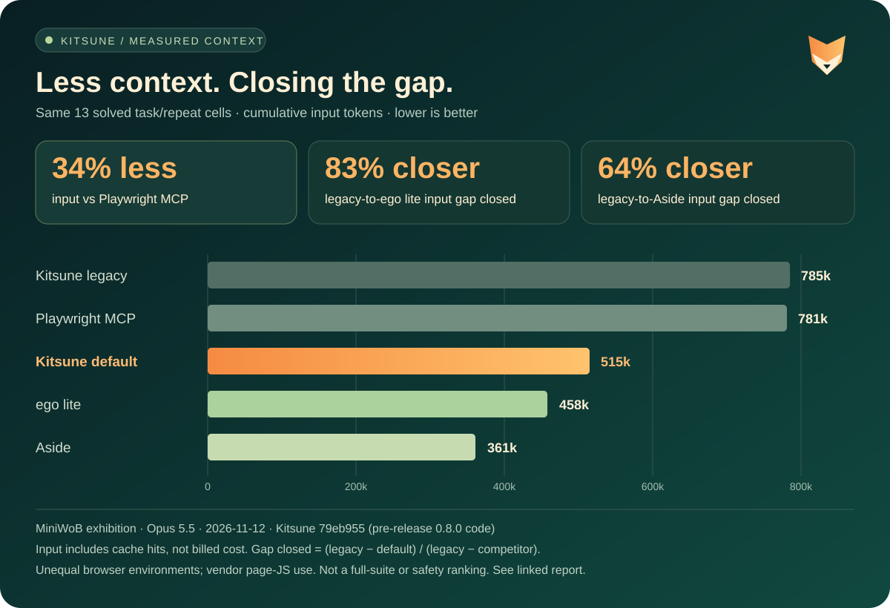

# Kitsune

<!-- mcp-name: io.github.junyeong-nero/kitsune -->


[](https://pypi.org/project/kitsune-browser-mcp/)
[](https://pypi.org/project/kitsune-browser/)
[](https://pypi.org/project/kitsune-browser-mcp/)
[](https://github.com/junyeong-nero/kitsune/releases/latest)
[](https://github.com/junyeong-nero/kitsune/blob/main/LICENSE)
[](https://junyeong-nero.github.io/kitsune/)

**Give your agent the browser you're already using. Keep working while it handles the busywork.**

Research products, compare pages, or fill forms—without signing in again or switching browsers.
Kitsune connects Claude Code, Codex, Pi and other MCP clients to Firefox, Zen or LibreWolf.
Your agent works in background tabs; your work stays in front.


<sub>Your agent asks for a tab. You approve, then take it back. <a href="https://github.com/user-attachments/assets/532e8a65-2801-4a4c-89b4-2ec8cec7322b">Watch the 45-second demo →</a></sub>

## Why Kitsune?

- **No fresh browser. No repeat logins.** Use your existing sessions. No Chromium or WebDriver to install.
- **Delegate without stepping aside.** The agent researches in background tabs while you keep browsing.
- **Your tabs stay yours.** The agent must ask before changing them. Approve, take back, and choose which tools need your OK.
- **A small tool surface.** Six tools on `main`, with Python for browser actions and direct controls for user help and recovery. The 0.8.0 release has 14.

## Less input. Broader tasks.

**The 6-tool Kitsune used the least total input in this four-way comparison.**
23 personal and UI conditions, two repeats; all four configurations completed **46/46 attempts**.

[](https://junyeong-nero.github.io/kitsune/benchmark/)

<sub>Codex gpt-6.1-sol, medium. Input includes cache, not billed cost. Browser environments and permissions differ.
6-tool adjusted time was 4.8% higher than 14-tool Kitsune and 6.6% higher than Aside; results vary by task.
<a href="https://junyeong-nero.github.io/kitsune/benchmark/">Results, methodology and limitations →</a></sub>

## Get started

1. Install [uv](https://docs.astral.sh/uv/getting-started/installation/).
2. [Install the browser extension](https://junyeong-nero.github.io/kitsune/installation/#2-install-the-browser-extension)
   in Firefox, Zen or LibreWolf.
3. Add Kitsune to your agent. For Claude Code:

   ```bash
   claude mcp add --scope user kitsune -- uvx --from kitsune-browser-mcp kitsune
   ```

   Codex, Pi, OpenCode, Claude Desktop and Cursor are in
   [Installation](https://junyeong-nero.github.io/kitsune/installation/#1-register-the-mcp-server).
4. Keep the browser open and ask in plain language:

   > Research these three products in background tabs and compare them with links.
   > Leave my current tab alone.

   > Fill in a draft of this form. Don't submit it.

**Trust note:** Python runs locally, not in a sandbox; set `KITSUNE_SCRIPTING=0` to disable it.
Approvals do not prevent prompt injection. Use a separate profile for sensitive accounts and
read the [security guide](https://junyeong-nero.github.io/kitsune/security/).

## Documentation

The full documentation is at **[junyeong-nero.github.io/kitsune](https://junyeong-nero.github.io/kitsune/)**:

- [Installation](https://junyeong-nero.github.io/kitsune/installation/): every MCP client, version pinning, upgrades
- [Your tabs and approvals](https://junyeong-nero.github.io/kitsune/your-tabs/): what limits the agent: protected tabs, per-tool approvals, ask-before-act
- [Tools](https://junyeong-nero.github.io/kitsune/tools/): the minimal and legacy tool lists, and the tool groups
- [Python API](https://junyeong-nero.github.io/kitsune/python-api/): drive the browser from your own scripts with `pip install kitsune-browser`
- [Troubleshooting](https://junyeong-nero.github.io/kitsune/troubleshooting/) ·
  [FAQ](https://junyeong-nero.github.io/kitsune/faq/) ·
  [Benchmarks](https://github.com/junyeong-nero/kitsune-benchmark) ·
  [API reference](https://junyeong-nero.github.io/kitsune/api-reference/)
