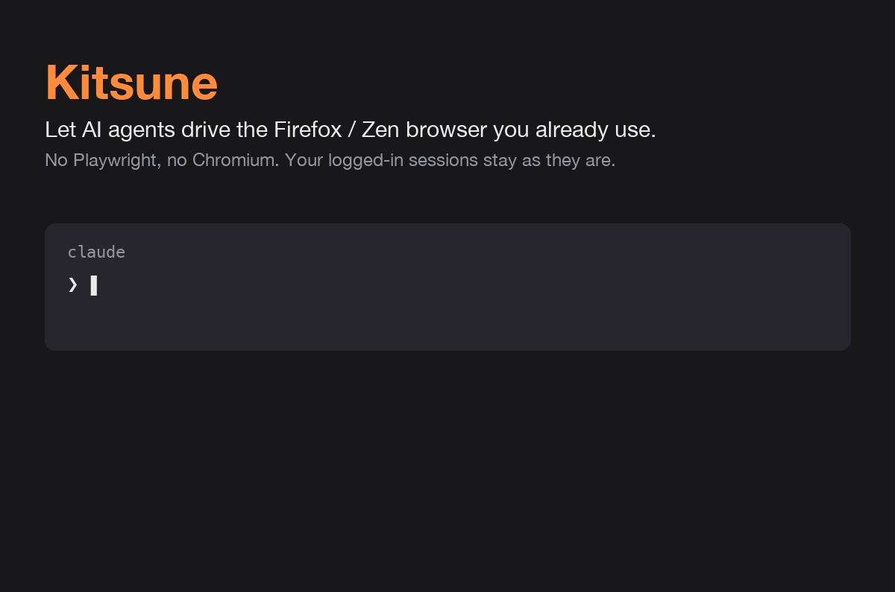

# Kitsune

An MCP server that lets AI agents (Claude Code, Codex, Pi, …) drive the
Firefox-family browser you already have open: Firefox, Zen, LibreWolf.



<sub>Frames captured by Kitsune itself (`browser_screenshot`) during a real run, sped up.</sub>

- **Your real browser.** Logged-in sessions, cookies and extensions stay as they are.
- **No Playwright, no Chromium, no WebDriver.** A WebExtension does the work, so
  there is no `navigator.webdriver` flag or debugging port.
- **Zero manual steps per session.** The MCP server starts a shared bridge daemon
  on demand; any number of agents can use it at once.

## How it works

```
agent ──stdio──▶ kitsune (MCP server, one per agent)
                    │ HTTP 127.0.0.1:47651 + bearer token
                    ▼
                 bridge daemon (one per user, started on demand)
                    │ WebSocket 127.0.0.1:47652, moz-extension:// origin only
                    ▼
                 Kitsune extension ──▶ tabs (content scripts)
```

1. The agent launches `kitsune` over stdio.
2. If no bridge is answering, `kitsune` spawns `python -m kitsune.bridge` as a
   detached daemon. A file lock makes sure only one agent spawns it.
3. The extension keeps reconnecting to the daemon, so it attaches by itself.
4. The daemon keeps running after the agent exits; the next agent reuses it.

## Requirements

- Firefox-family browser, Gecko 142+ (Zen 1.23 / Firefox 142 or newer)
- Python 3.10+ and [uv](https://docs.astral.sh/uv/)
- macOS or Linux (Windows untested since the fork)

## Setup

1. **Clone**
   ```bash
   git clone https://github.com/junyeong-nero/kitsune ~/workspace/kitsune
   ```
2. **Register the MCP server** in your agent. See [MCP clients](#mcp-clients).
3. **Load the extension**: open `about:debugging#/runtime/this-firefox` →
   **Load Temporary Add-on…** → pick `extension/manifest.json`
   (in the macOS file dialog, Cmd+Shift+G lets you paste the path).
   Temporary add-ons disappear when the browser restarts; signing is on the
   [TODO](docs/TODO.md).
4. **Check**: restart the agent and ask it to call `browser_status`. It should
   report `"extension_connected": true`.

## MCP clients

Kitsune is a stdio MCP server. Every client runs the same command:

```
uv run --directory /path/to/kitsune kitsune
```

Config files do not expand `~`, so use an absolute path there. If the client
cannot find `uv` (common for GUI apps), use its full path from `which uv`.

**Claude Code**

```bash
claude mcp add -s user kitsune -- uv run --directory ~/workspace/kitsune kitsune
```

**Codex CLI**

```bash
codex mcp add kitsune -- uv run --directory ~/workspace/kitsune kitsune
```

or in `~/.codex/config.toml`:

```toml
[mcp_servers.kitsune]
command = "uv"
args = ["run", "--directory", "/Users/you/workspace/kitsune", "kitsune"]
```

**opencode**: `~/.config/opencode/opencode.json` (global) or `opencode.json` at a git repo root
(project). Write it by hand: `opencode mcp add` (v2.0.28) writes `mcp.servers`, which `opencode mcp list` does not pick up.

```json
{
  "$schema": "https://opencode.ai/config.json",
  "mcp": {
    "kitsune": {
      "type": "local",
      "command": ["uv", "run", "--directory", "/Users/you/workspace/kitsune", "kitsune"],
      "enabled": true
    }
  }
}
```

**Claude Desktop / Cursor / other `mcpServers` clients**
(`claude_desktop_config.json`, `~/.cursor/mcp.json`, …):

```json
{
  "mcpServers": {
    "kitsune": {
      "command": "uv",
      "args": ["run", "--directory", "/Users/you/workspace/kitsune", "kitsune"]
    }
  }
}
```

Several clients can be configured at once; they share one bridge daemon.

## Tools

By default, Kitsune registers 28 `browser_*` tools in the `core` capability
group. Tab-aware tools accept `tab_id` to target background tabs.
Set `KITSUNE_CAPS` in the MCP server environment before starting it; restart the
MCP client after changing it. The comma-separated list selects exactly those
groups (include `core` to retain the default tools). `all` enables all 93 tools.
Whitespace and case are ignored; unknown group names fail at startup.

```toml
[mcp_servers.kitsune.env]
KITSUNE_CAPS = "core,network,parallel"
```

| Group | Tools |
|---|---|
| `core` (28) | `browser_status`, `browser_tabs`, `browser_page_info`, `browser_page_text`, `browser_forms`, `browser_dom`, `browser_screenshot`, `browser_navigate`, `browser_click`, `browser_type`, `browser_scroll`, `browser_hover`, `browser_find`, `browser_js`, `browser_wait_for`, `browser_workflows`, `browser_workflow`, `browser_markdown`, `browser_select_option`, `browser_check`, `browser_keypress`, `browser_submit_form`, `browser_form_fill`, `browser_upload_file`, `browser_back`, `browser_forward`, `browser_watch_console`, `browser_console_logs` |
| `devtools` (26) | `browser_trusted_click`, `browser_highlight`, `browser_cache`, `browser_reload_extension`, `browser_query`, `browser_html`, `browser_links`, `browser_images`, `browser_meta`, `browser_structured_data`, `browser_bounds`, `browser_computed_style`, `browser_readability`, `browser_iframes`, `browser_explain_selector`, `browser_focus`, `browser_blur`, `browser_double_click`, `browser_drag`, `browser_click_and_wait_navigation`, `browser_full_page_metrics`, `browser_health`, `browser_logs`, `browser_audit`, `browser_set_policy`, `browser_get_policy` |
| `network` (3) | `browser_downloads`, `browser_intercept`, `browser_capture_network` |
| `parallel` (15) | `browser_keep_alive`, `browser_keep_alive_stop`, `browser_parallel`, `browser_broadcast`, `browser_sync_barrier`, `browser_tag_tab`, `browser_resolve_tag`, `browser_list_tags`, `browser_untag_tab`, `browser_tab_pool`, `browser_pool_acquire`, `browser_pool_release`, `browser_scheduler`, `browser_retry`, `browser_batch` |
| `session` (4) | `browser_save_session`, `browser_load_session`, `browser_list_sessions`, `browser_delete_session` |
| `storage` (4) | `browser_cookies`, `browser_storage`, `browser_clipboard`, `browser_clear_browsing_data` |
| `tabs` (7) | `browser_wake_tab`, `browser_pin_tab`, `browser_mute_tab`, `browser_duplicate_tab`, `browser_reload_tab`, `browser_get_zoom`, `browser_set_zoom` |
| `windows` (6) | `browser_windows`, `browser_create_window`, `browser_close_window`, `browser_focus_window`, `browser_move_tab`, `browser_detach_tab` |

The consolidated tools use options for related operations:

- `browser_tabs(action="list"|"new"|"close"|"select", ...)`
- `browser_type(selector, text, mode="type"|"fill"|"editable", ...)`
- `browser_wait_for(selector=...|text=...|text_gone=...|js=...|url=...|title=...|network_idle=True|time=...)` (exactly one)
- `browser_screenshot(selector=None, full_page=False, ...)` returns a saved PNG path.

`browser_js` runs JavaScript in the page. WordPress Elementor extraction is
available as `browser_workflow("wp-html", {"site_url": "https://example.com", "page_id": 5719})`.
See the [API reference](docs/api-reference.md) for merged tool signatures and behavior,
and the [before/after inventory](docs/tool-surface.md) for the complete tool lists.

Every tool includes MCP annotations with a human-readable title and read-only,
destructive, idempotent, and open-world hints. Clients can use these hints to
inform permission prompts; enforcement depends on the client. Tools combining
read and write operations are annotated for their most dangerous operation,
including when called in a read mode.

## Configuration

| Variable | Default | Meaning |
|---|---|---|
| `KITSUNE_CAPS` | `core` | Comma-separated capability groups above; `all` enables everything |
| `KITSUNE_HOME` | `~/.kitsune` | Data directory (0700) |
| `KITSUNE_HTTP_PORT` | `47651` | Bridge HTTP API |
| `KITSUNE_WS_PORT` | `47652` | Extension WebSocket. Change `WS_URL` in `extension/background/background.js` too |
| `KITSUNE_TOKEN` | — | Override the token in `~/.kitsune/token` |

`~/.kitsune/` holds:

| File | Content |
|---|---|
| `token` | Bearer token for the HTTP API (0600, created on first start) |
| `bridge.log` | Daemon output |
| `sessions/` | Saved sessions, **including cookies** |
| `screenshots/` | Screenshots |

## Security

What the bridge protects against:

- **Web pages calling the local API.** The HTTP API needs the bearer token and
  sends no CORS headers, so a page in the browser cannot use it.
- **DNS rebinding.** Requests with a `Host` other than `127.0.0.1` / `localhost`
  are rejected.
- **Web pages posing as the extension.** The WebSocket only accepts
  `moz-extension://` origins. Before this check, any page could connect and
  take over the extension's slot.

What it does not protect against:

- **Prompt injection.** A page the agent reads can contain instructions. The
  agent acts with every account you are logged into.
- **Local processes** running as your user can read the token.

Recommended: use a separate browser profile that only has the accounts the
agent needs, and keep banking, mail and work SSO out of it.

## Troubleshooting

| Symptom | Check |
|---|---|
| `extension_connected: false` | Extension loaded? Browser restarted (temporary add-on gone)? |
| `Kitsune bridge did not start` | `~/.kitsune/bridge.log`; another process on port 47651/47652 (`lsof -nP -iTCP:47651`) |
| `401 Missing or invalid token` | `KITSUNE_TOKEN` set in the client but not in the daemon (or the other way round) |
| `Cannot access browser internal page` | `about:` pages are off-limits to extensions; switch to a normal tab |
| Restart the daemon | `pkill -f kitsune.bridge`; the next tool call starts it again |

## Layout

```
extension/          WebExtension (manifest v2, Gecko)
src/kitsune/
  server.py         MCP server, starts the bridge on demand
  bridge.py         Bridge daemon (HTTP API + WebSocket)
  workflows/        Named workflows for browser_workflow
docs/               API reference, scraping playbooks, TODO
```

## Credits

Kitsune started as a fork of [ZenLink](https://github.com/JayQuan-McCleary/ZenLink)
and [ZenLink-MCP](https://github.com/JayQuan-McCleary/ZenLink-MCP) by Jay-Quan
(MIT). Changes since the fork: token auth, Host and origin checks, no CORS,
on-demand shared daemon, one package, `browser_*` tool names, `~/.kitsune` data
directory, macOS support, `mcp<2` pin.

## License

MIT. See [LICENSE](LICENSE).
