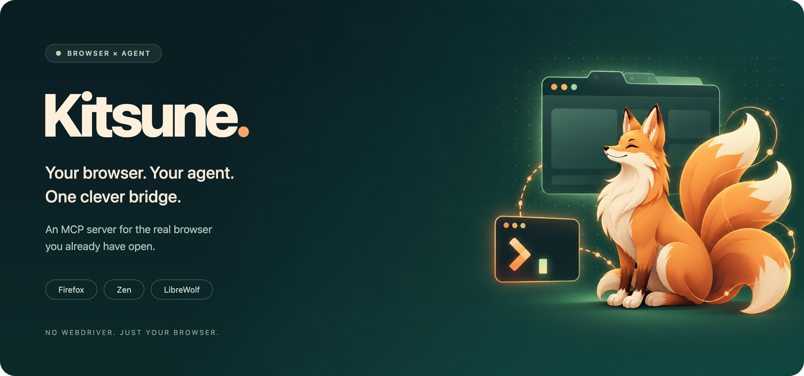
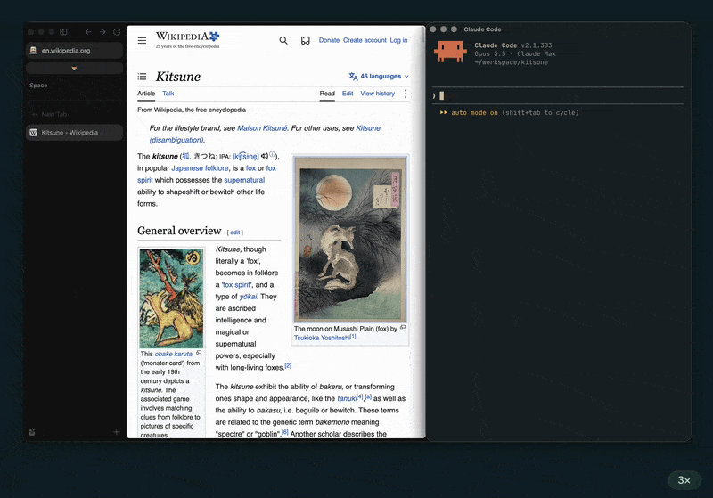

# Kitsune

<!-- mcp-name: io.github.junyeong-nero/kitsune -->



[](https://pypi.org/project/kitsune-browser-mcp/)
[](https://pypi.org/project/kitsune-browser/)
[](https://pypi.org/project/kitsune-browser-mcp/)
[](https://github.com/junyeong-nero/kitsune/releases/latest)
[](https://github.com/junyeong-nero/kitsune/blob/main/LICENSE)
[](https://junyeong-nero.github.io/kitsune/)

**Let your coding agent use the browser you already have open, while you keep using it too.**

Kitsune connects Claude Code, Codex, Pi, OpenCode and other MCP clients to Firefox, Zen or
LibreWolf. The agent works in background tabs of its own, signed in wherever you are signed in.
It can read your tabs, but it has to ask before it changes one. There is no Playwright,
Chromium or WebDriver to install.



<sub>New in 0.7.2: the agent asks for your tab, and you approve, take it back and clean up from the toolbar popup. A real recording on Wikipedia, sped up while the agent thinks (<a href="https://github.com/user-attachments/assets/532e8a65-2801-4a4c-89b4-2ec8cec7322b">full 45-second video</a>).</sub>

## Why Kitsune?

- **It works beside you.** New tabs open in the background, so the page you are on stays in
  front. Your tabs, and tabs other agents opened, are read-only to the agent: it can read them,
  but it cannot click, type, scroll, navigate or close them. If you start typing in one of the
  agent's own tabs, it waits.
- **You stay in charge.** When the agent needs one of your tabs, it asks, and you answer in
  Kitsune's toolbar popup. You can take the tab back at any time. The popup also shows whether
  the agent is connected, and closes all of the agent's tabs with one click. Tabs the agent
  leaves idle close by themselves after five minutes (you can change this in the popup).
- **The tools are familiar.** The agent starts with Playwright MCP's 25 core tools, under the
  same names, plus `browser_ask_user` and `browser_resume` for when it needs you. Prompts written
  for Playwright MCP work unchanged. More tools (page text, forms, batches, downloads, …) stay off
  until you allow them.
- **You decide how much to hand over.** `KITSUNE_MODE=read`, `draft` or `act` limits what the
  agent can do. In draft mode it can fill in forms but cannot click or submit.

## Get started

1. Install [uv](https://docs.astral.sh/uv/getting-started/installation/).
2. [Install the browser extension](https://junyeong-nero.github.io/kitsune/installation/#2-install-the-browser-extension)
   in Firefox, Zen or LibreWolf.
3. Add Kitsune to your agent. For Claude Code:

   ```bash
   claude mcp add --scope user kitsune -- uvx --from kitsune-browser-mcp kitsune
   ```

   Codex, Pi, OpenCode, Claude Desktop and Cursor are in
   [Installation](https://junyeong-nero.github.io/kitsune/installation/#1-register-the-mcp-server).
4. Keep the browser open and ask in plain language:

   > Research these three products in background tabs and compare them with links.
   > Leave my current tab alone.

   > Fill in a draft of this form. Don't submit it.

Kitsune starts its local bridge on its own. If the agent cannot connect, ask it to check the
connection: the error's `hint` says what to fix.

Use a separate browser profile for agent work and sign in only to the accounts it needs.
Ask the agent to check with you before it sends, buys or deletes anything. Nothing in Kitsune
stops prompt injection, so read the [security guide](https://junyeong-nero.github.io/kitsune/security/)
before using sensitive accounts.

## Documentation

The full documentation is at **[junyeong-nero.github.io/kitsune](https://junyeong-nero.github.io/kitsune/)**:

- [Installation](https://junyeong-nero.github.io/kitsune/installation/): every MCP client, version pinning, upgrades
- [Your tabs and approvals](https://junyeong-nero.github.io/kitsune/your-tabs/): what the agent may do to your tabs, and how you approve
- [Tools, capabilities and modes](https://junyeong-nero.github.io/kitsune/tools/): `KITSUNE_CAPS`, `KITSUNE_PUBLISH` and `KITSUNE_MODE`
- [Python API](https://junyeong-nero.github.io/kitsune/python-api/): drive the browser from your own scripts with `pip install kitsune-browser`
- [Troubleshooting](https://junyeong-nero.github.io/kitsune/troubleshooting/) ·
  [FAQ](https://junyeong-nero.github.io/kitsune/faq/) ·
  [Benchmark and comparison](https://junyeong-nero.github.io/kitsune/benchmark/) ·
  [API reference](https://junyeong-nero.github.io/kitsune/api-reference/)
