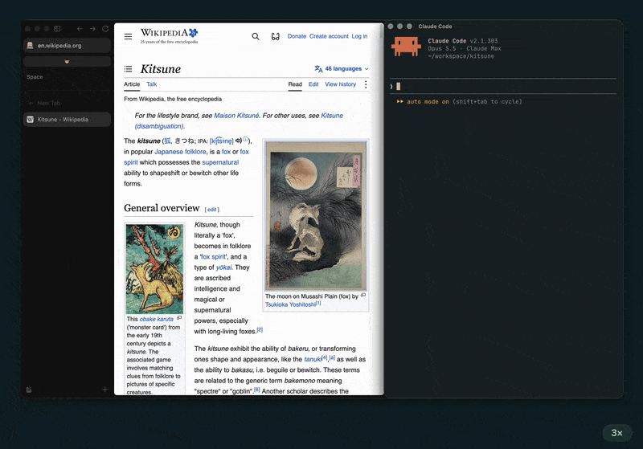

# Kitsune

<!-- mcp-name: io.github.junyeong-nero/kitsune -->


[](https://pypi.org/project/kitsune-browser-mcp/)
[](https://pypi.org/project/kitsune-browser/)
[](https://pypi.org/project/kitsune-browser-mcp/)
[](https://github.com/junyeong-nero/kitsune/releases/latest)
[](https://github.com/junyeong-nero/kitsune/blob/main/LICENSE)
[](https://junyeong-nero.github.io/kitsune/docs/)

**Delegate browser tasks. Keep your browser yours.**

Kitsune connects Claude Code, Codex, Pi and other MCP clients to the Firefox, Zen or LibreWolf
browser you already use. It's built for personal browser tasks—researching products, comparing
pages, and drafting forms—rather than cross-browser testing. Your agent opens its own background
tabs while you keep working in yours.



<sub>Your agent asks for a tab. You approve, then take it back. <a href="https://github.com/user-attachments/assets/532e8a65-2801-4a4c-89b4-2ec8cec7322b">Watch the 45-second demo →</a></sub>

## Why Kitsune?

I built Kitsune after getting tired of switching back to my tab whenever my Playwright setup
took focus, and opening Chrome for my agent when I already used a Firefox-based browser.
I wanted browser automation that worked alongside me, not in my way.

- **Keep working while the agent works.** Agent-created tabs open in the background. Selecting a tab for the agent doesn't switch the tab you see.
- **Your tabs stay yours.** By default, the agent can read your tabs but cannot type, navigate, scroll or close them. It must request a handoff before changing one; you approve and can take it back.
- **Stay in Firefox, Zen or LibreWolf.** Reuse your existing sessions without opening a separate Chrome browser or installing WebDriver.
- **A small tool surface.** Six tools: Python for browser actions, plus direct controls for user help and recovery.

Kitsune is designed to reduce interruptions, not eliminate them: site-opened popups and
OS-level trusted input can still move focus. See the
[shared-browser limits](https://junyeong-nero.github.io/kitsune/docs/api-reference/#shared-browser).

## Same success. Less input.

**On 26 realistic web tasks Kitsune passed as many as Playwright MCP, with about 40% of its input and half its tool calls.**
Aside, EgoLite, Playwright MCP and Kitsune on 26 [WebArena-Pro](https://arxiv.org/abs/2611.17955) tasks under
Claude Code: 104 attempts, graded by the sites' backend state and the agent's answer. Success was tied: all four
passed the same 12 tasks.

[](https://junyeong-nero.github.io/kitsune/docs/benchmark/)

<sub>claude-opus-5-5, one attempt per task. Input includes cache, not billed cost. Grading has no LLM judge, so it is
stricter than the WebArena-Pro paper's and not comparable to its scores. Aside and EgoLite used the operator's
browsers; Playwright MCP and Kitsune ran an isolated Firefox. EgoLite made slightly fewer tool calls than Kitsune.
<a href="https://junyeong-nero.github.io/kitsune/docs/benchmark/">Results, methodology and limitations →</a></sub>

## Get started

1. Install [uv](https://docs.astral.sh/uv/getting-started/installation/).
2. [Install the browser extension](https://junyeong-nero.github.io/kitsune/docs/installation/#2-install-the-browser-extension)
   in Firefox, Zen or LibreWolf.
3. Add Kitsune to your agent. For Claude Code:

   ```bash
   claude mcp add --scope user kitsune -- uvx --from kitsune-browser-mcp kitsune
   ```

   Codex, Pi, OpenCode, Claude Desktop and Cursor are in
   [Installation](https://junyeong-nero.github.io/kitsune/docs/installation/#1-register-the-mcp-server).
4. Keep the browser open and ask in plain language:

   > Research these three products in background tabs and compare them with links.
   > Leave my current tab alone.

   > Fill in a draft of this form. Don't submit it.

**Trust note:** Python runs locally, not in a sandbox; set `KITSUNE_SCRIPTING=0` to disable it.
Approvals do not prevent prompt injection. Use a separate profile for sensitive accounts and
read the [security guide](https://junyeong-nero.github.io/kitsune/docs/security/).

## Documentation

The full documentation is at **[junyeong-nero.github.io/kitsune/docs](https://junyeong-nero.github.io/kitsune/docs/)**:

- [Installation](https://junyeong-nero.github.io/kitsune/docs/installation/): every MCP client, version pinning, upgrades
- [Your tabs and approvals](https://junyeong-nero.github.io/kitsune/docs/your-tabs/): what limits the agent: protected tabs, per-tool approvals, ask-before-act
- [Tools](https://junyeong-nero.github.io/kitsune/docs/tools/): the default and legacy tool lists
- [Python API](https://junyeong-nero.github.io/kitsune/docs/python-api/): drive the browser from your own scripts with `pip install kitsune-browser`
- [Troubleshooting](https://junyeong-nero.github.io/kitsune/docs/troubleshooting/) ·
  [FAQ](https://junyeong-nero.github.io/kitsune/docs/faq/) ·
  [Benchmarks](https://github.com/junyeong-nero/kitsune-benchmark) ·
  [API reference](https://junyeong-nero.github.io/kitsune/docs/api-reference/)
