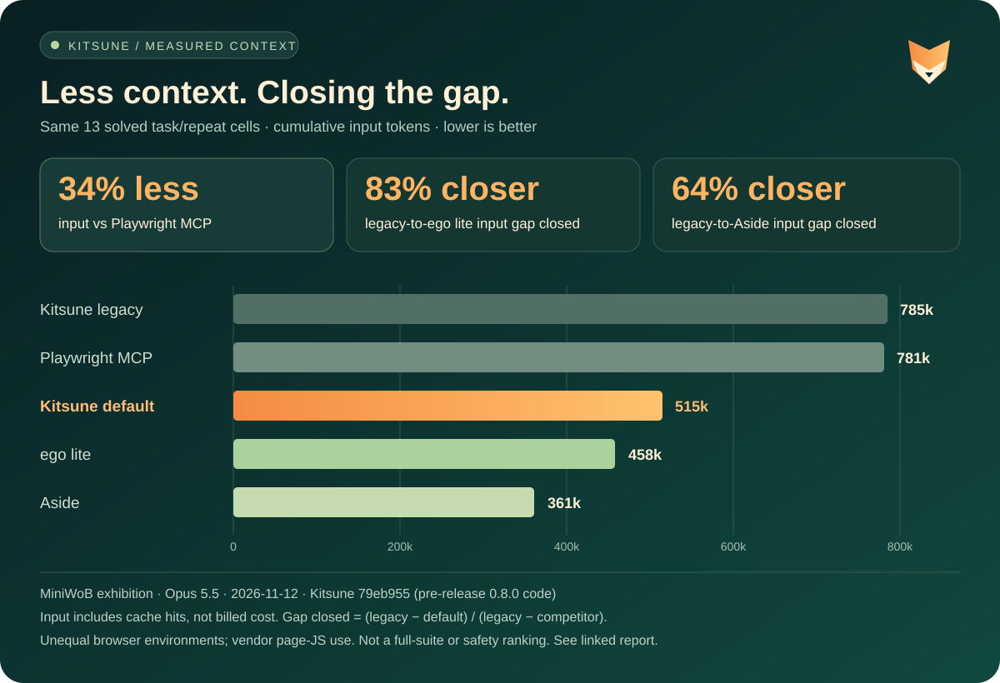

# Benchmark and comparison

## Four-way comparison (2026-11-13)

23 conditions (7 personal browser, 10 isolated UI, 6 crowded UI) × 2 repeats × 4 arms.
Every arm completed **46/46** attempts.

| Arm | Success | Input incl. cache | Adjusted elapsed, s |
| --- | ---: | ---: | ---: |
| Kitsune 6-tool | 46/46 | **5,730,439** | 1,324.975 |
| Kitsune 14-tool (0.8.0 default) | 46/46 | 5,901,946 | 1,264.414 |
| Aside | 46/46 | 5,923,875 | **1,242.744** |
| EgoLite | 46/46 | 7,775,055 | 1,478.044 |

Six-tool Kitsune used 2.9% less input than 14-tool Kitsune, 3.3% less than Aside and 26.3% less
than EgoLite. It was not faster: adjusted elapsed was 4.8% higher than 14-tool Kitsune and 6.6%
higher than Aside.

Limits:

- Codex CLI 0.163.0, `gpt-6.1-sol`, medium reasoning. Input tokens, not billed cost.
- Browser engines, profiles, viewports and tab protections differ between arms.
- Results vary by task: Aside used less input in 36/46 paired cells. Two repeats do not establish
  statistical superiority.
- No handoff or approval recovery was exercised.

Source: `kitsune-benchmark/docs/results/2026-11-13-expanded-four-way-codex.md`.

## Earlier results

- **Five-way MiniWoB (2026-11-12):** on 13 shared successful cells, Kitsune's then-default
  14 tools used 34.1% less input than Playwright MCP, but 12.4% more than ego lite and 42.6% more
  than Aside ([report](https://github.com/junyeong-nero/kitsune-benchmark/blob/main/docs/results/2026-11-12-five-way-main-79eb955.md)).
- **v0.7.2 vs Playwright MCP:** Kitsune kept the user's tab in front in 28/28 tasks (Playwright
  MCP 2/28), cost 0.56–0.97× on tasks both solved, and solved 96/98 tasks (Playwright MCP 98/98)
  ([report](https://github.com/junyeong-nero/kitsune-benchmark/blob/main/docs/results/2026-11-04-opus-subscription-v0.7.2.md)).

All reports: [kitsune-benchmark](https://github.com/junyeong-nero/kitsune-benchmark/tree/main/docs/results).

## How is it different?

| If you want to… | Consider |
| --- | --- |
| Hand tasks to an agent in the Firefox-family browser you use, with background tabs and approvals | **Kitsune** |
| Debug or profile pages in Firefox | [Firefox DevTools MCP](https://github.com/mozilla/firefox-devtools-mcp) |
| Test across Chromium, Firefox and WebKit in browsers it launches | [Playwright MCP](https://github.com/microsoft/playwright-mcp) |
| Drive the Chrome you already use | A Chromium extension MCP such as [Browser MCP](https://github.com/BrowserMCP/mcp) |
