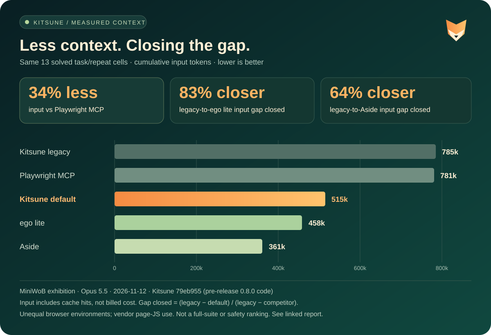
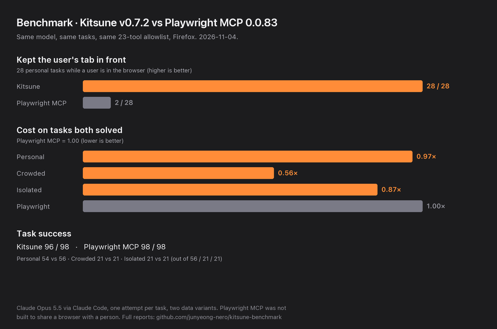

# Benchmark and comparison

## Smaller tool surface: five-way MiniWoB comparison

The 2026-11-12 exhibition compares Kitsune's default and legacy surfaces on the **same source
revision**, alongside Playwright MCP, ego lite and Aside. It is seven tasks with two repeats per
arm (70 attempts), not a completed standard-lite suite or an equal-environment leaderboard.

### Shared successful cells

Every row below uses the **same 13 task/repeat cells successful for all five arms**. The one
cell ego failed is removed from every arm. Input includes cache hits; these are token totals,
not billed cost or browser-action counts.

| Arm | Input tokens, shared 13 cells | Raw success, all 14 attempts |
| --- | ---: | ---: |
| Kitsune legacy | 785,115 | 14/14 |
| Playwright MCP | 781,019 | 14/14 |
| Kitsune default | 514,964 | 14/14 |
| ego lite | 458,052 | 13/14 |
| Aside | 361,014 | 14/14 |

- **34.1% less input than Playwright:** `1 − 514964 / 781019`.
- **82.6% of the legacy-to-ego input gap closed:** `(785115 − 514964) / (785115 − 458052)`.
- **63.7% of the legacy-to-Aside input gap closed:** `(785115 − 514964) / (785115 − 361014)`.
- Kitsune still uses **12.4% more input than ego** and **42.6% more than Aside** on this set.

“Gap closed” compares default versus legacy on the same Kitsune commit, not progress across
historical releases. It is not a claim of equivalent performance in every dimension.

### Conditions and limits

- Claude Code 2.1.303, Claude Opus 5.5 (`claude-opus-5-5`), medium reasoning, subscription.
- Kitsune `79eb95594eee57bf429c1594c883f1995294dbc8`: pre-release 0.8.0 code, not the final
  release tag. Default: 14 tools; legacy: 30 tools, `KITSUNE_SCRIPTING=0`; no benchmark allowlist.
- Playwright MCP 0.0.83: 23 tools under the benchmark's standard UI allowlist. ego lite 0.6.2.9:
  one `run_script` tool. Aside CLI/native MCP 1.26.1107.24 (app 1.0.1022.1): one `repl` tool.
- MiniWoB `33c3b4ddef8c6eb67c57a29663d844b1eda7e614`, seed 42. Tasks: `click-test-2`,
  `click-checkboxes`, `enter-text`, `choose-list`, `login-user`, `use-autocomplete`, `book-flight`.
  All planned attempts were scorable; no episode retries or replacements. ego failed `book-flight` r1.
- Kitsune made **zero Python calls**: this supports a smaller observed tool/prompt prefix,
  not a measured Python batching benefit. Across the full 14-cell Kitsune-only comparison,
  input fell 33.1%, but model requests rose 4.2% and MCP calls rose 2.3%.
- Kitsune/Playwright used fresh private headless Firefox. ego/Aside used installed warm browsers;
  engines, profiles and effective viewports were not equal. No isolation equivalence is claimed.
- Page-JS code was emitted in eight ego attempts and one Aside attempt, including successful
  attempts. These remain in the primary results; raw success is **not** strict UI-only compliance.
  On pairwise successful cells excluding page-JS use, ego/default input was 0.905 (6 cells),
  Aside/default 0.684 (13 cells). These smaller, selected subsets are not replacements for the chart.
- This small exhibition does not establish statistical superiority, approval safety, full-suite
  performance, or general speed/cost savings.

Source: `kitsune-benchmark/docs/results/2026-11-12-five-way-main-79eb955.md`, sections
“All-attempt totals” and “Matched efficiency, not success-blind totals”; benchmark execution
commit `d75bbff586890f0857e6d947189ad0895fd7edf2`. The figures and limitations above are reproduced
here so the README comparison does not depend on access to the benchmark repository.

## Earlier benchmark: v0.7.2

Same tasks, same model (Claude Opus 5.5), same tool allowlist, one run per task:

- **Your tab stays in front.** While a user was in the browser, Kitsune v0.7.2 never moved their view in 28 tasks.
  Playwright MCP, which was not built to share a browser with a person, moved it in 26.
- **It costs less.** On the tasks both solved, Kitsune cost 0.56 to 0.97 times as much as Playwright MCP.
- **It solves about as many.** Kitsune solved 96 of 98 tasks, Playwright MCP 98. Kitsune's two misses are one
  task, "go back to the tab I was on", in two variants: the user's tab stayed in front, but the agent's own tab was
  still its current tab, and that is what the grader checks.

See the [v0.7.2 report](https://github.com/junyeong-nero/kitsune-benchmark/blob/main/docs/results/2026-11-04-opus-subscription-v0.7.2.md)
and the [full reports](https://github.com/junyeong-nero/kitsune-benchmark/tree/main/docs/results).
`scripts/benchmark_chart.py` draws the chart from the report's numbers.

## How is it different?

| If you want to… | Consider |
| --- | --- |
| Hand tasks to an agent in the Firefox-family browser you are using, with background tabs and per-tool approvals | **Kitsune** |
| Debug or profile pages in Firefox (debugger, profiler, deep protocol access) | [Mozilla Firefox DevTools MCP](https://github.com/mozilla/firefox-devtools-mcp), which attaches to a Firefox started with remote-debugging flags |
| Test across Chromium, Firefox and WebKit in browsers it launches | [Playwright MCP](https://github.com/microsoft/playwright-mcp); Kitsune uses the same core tools, so prompts carry over |
| Drive the Chrome you already use | A Chromium extension MCP such as [Browser MCP](https://github.com/BrowserMCP/mcp) |

Kitsune connects through an extension and a local bridge, so Firefox needs no startup flags.
Other Firefox extensions also reuse your logins; Kitsune focuses on sharing the browser with you
while the agent works. [Positioning](https://github.com/junyeong-nero/kitsune/blob/main/docs/positioning.md)
has the full comparison.
