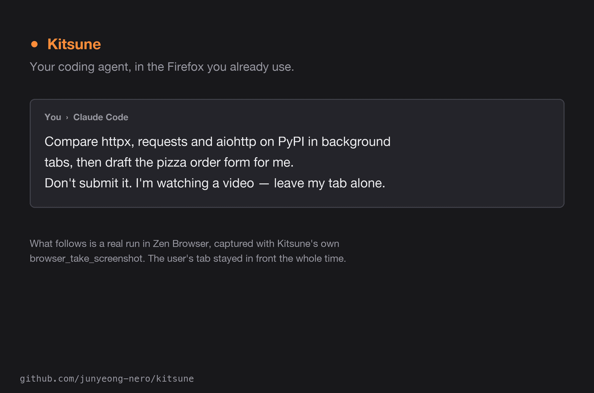

# Try it

Once [installed](installation.md), ask your agent:

> Open a new tab, search for today's weather near Suseong Lake in Daegu,
> and summarize the forecast with a link to the source. Leave the tab open.

Or:

- "Open Hacker News and summarize the top three stories with links."
- "Inspect this page's form and fill a draft. Don't submit it yet."
- "Capture a screenshot of this page and save it to a file."

A real screen recording, sped up while the agent thinks (<a href="https://github.com/user-attachments/assets/9b61f335-073d-4035-b479-ee03e96ae202">full 38-second video</a>).

The agent opens its own background tab first (`browser_tabs` `new`), then reads and acts on it.
Writes to your tabs are refused, so it never acts on the tab you are using
([Shared browser](api-reference.md#shared-browser)). Ask it to confirm before submitting,
sending, buying or deleting. Page content is untrusted input; see [Security](security.md).

To drive the browser from your own code, see the [Python API](python-api.md).
