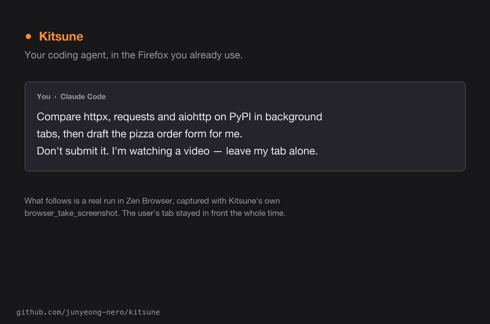

# Try it

Once [installed](installation.md) and your tabs are listed, ask your agent:

> Open a new tab, search for today's weather near Suseong Lake in Daegu,
> and summarize the forecast with a link to the source. Leave the tab open.

Or try:

- “Open Hacker News and summarize the top three stories with links.”
- “Inspect this page's form and fill a draft. Don't submit it yet.”
- “Capture a screenshot of this page and save it to a file.”



<sub>A real screen recording of Claude Code and Zen on the live Google sites, sped up while the agent thinks (<a href="https://github.com/user-attachments/assets/9b61f335-073d-4035-b479-ee03e96ae202">full 38-second video</a>).</sub>

A typical tool sequence looks like this (Python-style pseudocode; these are MCP
calls made by your agent; to drive the browser from your own code, see the
[Python API](python-api.md)):

```python
browser_tabs(action="new", url="https://example.com")  # the new tab becomes current
browser_snapshot()
# Inspect the returned snapshot, then use a ref from that result:
# browser_click(target="<latest ref>", element="More information")
browser_take_screenshot(filename="/tmp/kitsune-example.png")
```

Open a dedicated tab first (`browser_tabs` `new`) so the tools act on it. Until there is
one, reads act on the active tab, and writes and navigations that name no tab fail with
`no_current_tab` instead of acting on it. You and the agent share the browser: the agent's tabs open
in the background, it closes only tabs it opened unless you approve, and it backs off
from a tab you are using (see
[Shared browser](api-reference.md#shared-browser)). Ask the agent to confirm before submitting forms,
sending messages, purchasing, or deleting data. Page content is untrusted input,
not permission to take additional actions; see [Security](security.md).
